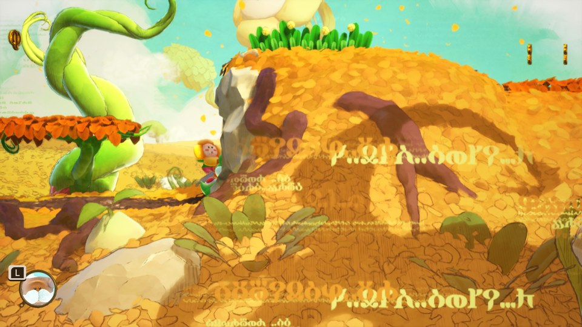
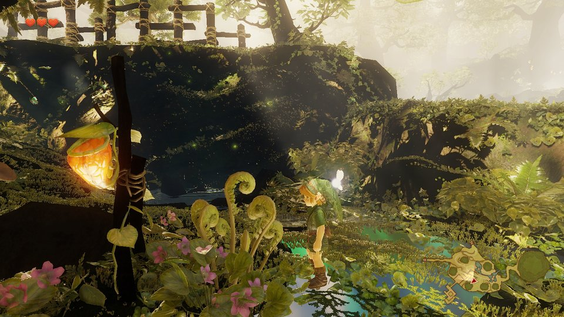
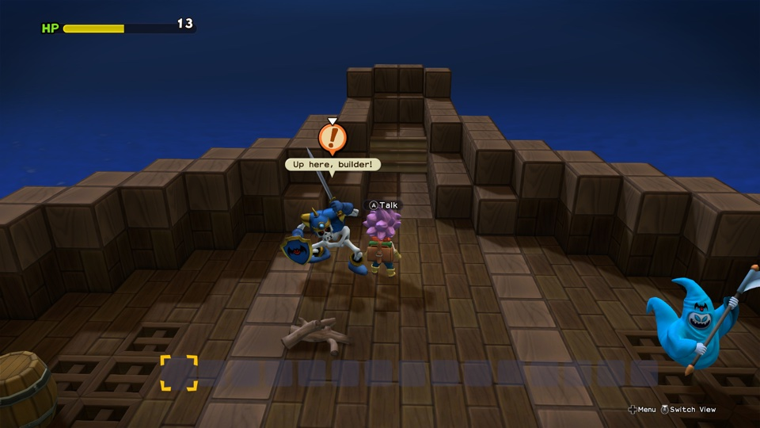
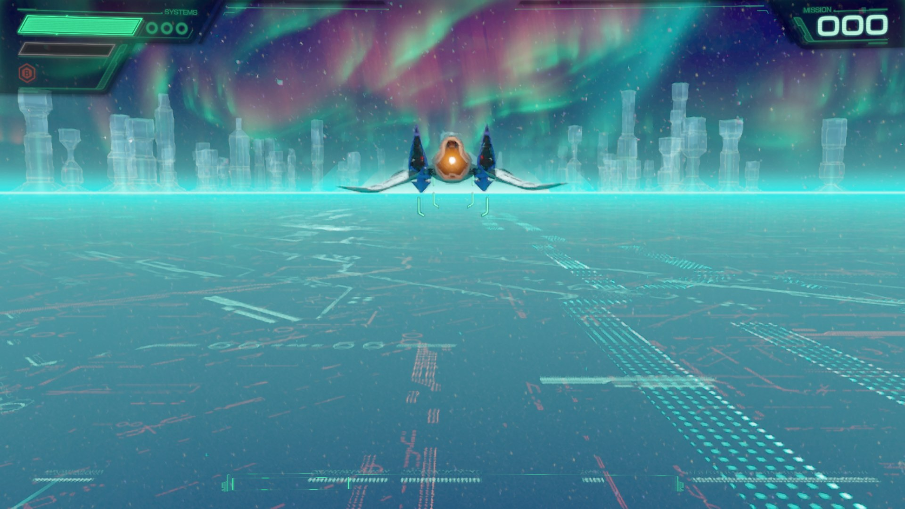
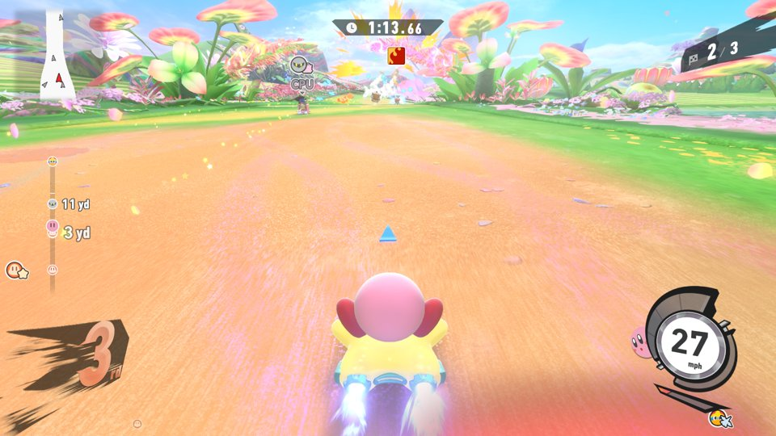
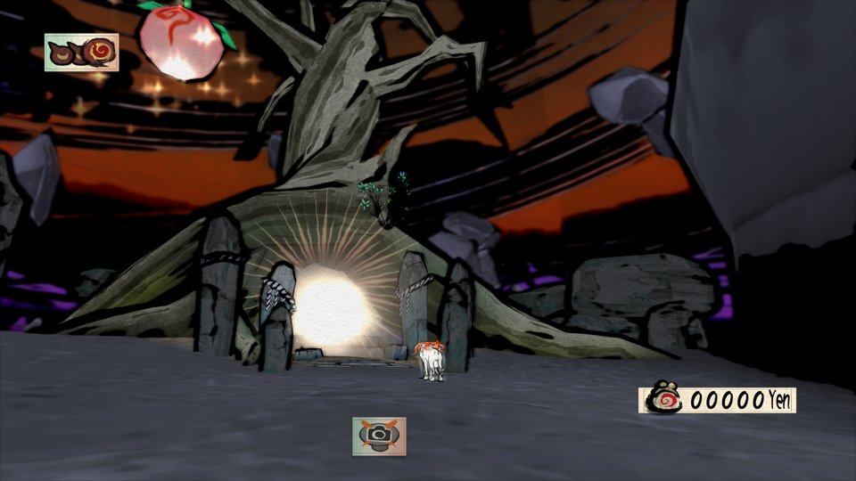
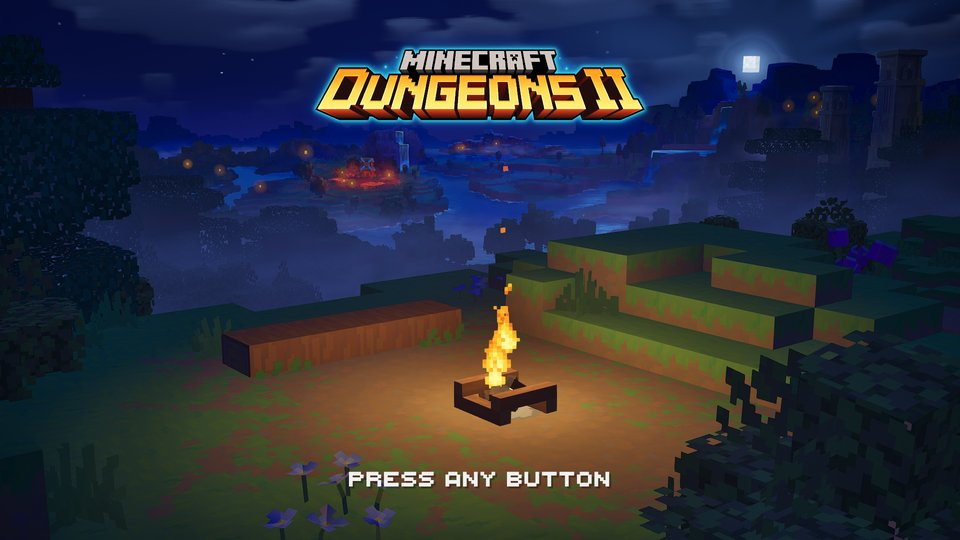
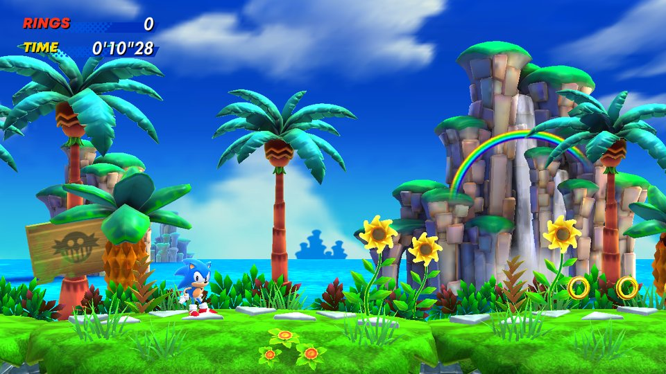

# TVPort 1.2.3


## What this fork adds (brad-n/TVPort)

Changes in this fork that the TVPort and nxnative releases don't have yet, in plain terms. This fork's TVPort shows **Version 1.3.0** in About, with a build number that goes up with every change, so you can tell which build you're running. Upstream fixes we brought in early are listed with their pull request numbers, so they're easy to drop once upstream accepts them.

**Smaller games on the Apple TV**
- **Store textures once:** the game's textures are kept once, in the Apple TV's own format, instead of twice (original plus converted copy). Mario Kart 8 Deluxe went from 21.5 GB to 13.6 GB.
- **Compress game data:** the game file on the Apple TV is compressed without losing anything and unpacked as it's read. Mario Kart 8 Deluxe went from 13.6 GB to 9.3 GB.
- **More textures converted ahead of time:** more of the Switch's texture formats (BC4, BC5, BC6H) are converted on the Mac before install, so the Apple TV does less work while you play.
- **Texture size cap for native ASTC textures:** large textures that are already in the Apple TV's format (mostly Switch 2 games) are shrunk to the cap you choose. At a cap of 256, Ocarina of Time's textures use about 90% less memory.

**Switch 2 games (experimental)**
- **Switch 2 game files (`.nup`):** TVPort finds and builds them, needs no keys, and names the app from the folder when the package carries no name.
- **Larger address space:** Switch 2 games reserve about 12.5 GB of memory addresses, which tvOS only allows with Apple's Extended Virtual Addressing permission. TVPort asks for it only for games that need it. This needs a paid Apple Developer Program account, plus a one-time step per game on Apple's developer site to enable the permission for that game's app ID.
- **App icon, Top Shelf art and game info from Nintendo's store:** the public title list TVPort normally uses has no Switch 2 games, so a Switch 2 game used to get no icon and no details in SwitchTV. When that list has nothing for a game, TVPort now looks the game up on Nintendo's own store page and uses its picture as the app icon and Top Shelf art, and its name, description, publisher, release date and genres in SwitchTV. It only fills gaps: artwork you chose, or anything the title list already has, is left alone, and with no internet the game just has no art, as before.

**Fixes from upstream pull requests, included early** (nxnative by seedds; not yet merged upstream)
- **#1459:** the "use Apple's MetalFX upscaler" setting now works on Ocarina of Time. It was looking for the wrong file, so it did nothing.
- **#1543:** when Ocarina of Time runs below 60 fps, the game keeps real-time speed, so it looks choppier instead of going into slow motion.

## What’s new in TVPort 1.2.3 build 44

- Added separate Swap A/B and Swap X/Y controls. Existing combined swaps stay enabled, and new games inherit your most recent choices.
- Reduced automatic save checks to every 30 minutes. Backups are still created only when saves change, keeping the newest 10 automatic copies per game and player/save slot.
- Kept Updates & DLC attachments editable during automatic save checks and fixed the Add Files dialog.
- Kept separate generated game profiles when input files change, fixing the cached base-game profile error when adding an update. Previous profiles are preserved for switching back.
- Made Last Run show the complete available run log, added text-file export for build and run logs, and made the build log follow new output. Save Log now sits beside the status and Show/Hide Log controls.
- Kept the prod.keys picker visible in game settings.
- Made Crop to fill the default for new App Icons and when choosing replacement artwork. Top Shelf uses the App Icon image unless a separate cover is selected, with a clearer Use App Icon Image action.
- Added an in-app warning that Updates & DLC support is under development and may cause games to crash.

Known issue: Snufkin reached gameplay with the newer engine without the game update, but the updated game still crashes during loading. The latest updated-game log repeats the same null-pointer fault as earlier tests. The cause remains under investigation; Updates has not been isolated as the cause. This is not a confirmed crash fix.


## What’s new in TVPort 1.2.3

- Added a build queue: prepare several games, see Building and numbered Queued badges, and remove waiting games. Stop or a failed build pauses the queue until you resume it.
- Added each built game’s signing expiry, with a live countdown and local date and time.
- Kept the Mac awake during setup, conversion, building and installation. The display can still turn off, and normal sleep resumes when the work finishes or stops.
- Added a confirmation after a save is successfully restored and verified on Apple TV, with an in-app fallback when notifications are unavailable.
- Automatically back up saves for all supported games installed on the selected Apple TV, including games built on another Mac.
- Save automatic backups only when their contents change, keeping the newest 10 per game and player/save slot. Manual backups, local imports, safety backups and older unlabelled copies are preserved.
- Kept saved backups available to browse during automatic backup, with clearer progress and retry messages. Builds can wait in the queue until backup finishes.
- Added drag-to-position for App Icon and Top Shelf artwork, cached previews for faster switching, and Crop to fill as the default for new Top Shelf covers.
- Fixed artwork disappearing after Stop and build results or installation messages appearing on the wrong game.

See the [1.2.3 changelog](tvport/CHANGELOG-1.2.3.md) for validation and release details. Earlier features and instructions remain below.

## What’s new in TVPort 1.2

- Updated the embedded nxnative engine and shader tools while retaining TVPort’s Apple TV adaptations.
- Fixed Unity 6000.3 shader parsing and the Apple TV startup check that incorrectly rejected GPUs using decoded BC textures.
- Added drag-and-drop for game folders and NSP, XCI, NSZ and XCZ files.
- Added an Updates & DLC section: attach files from other folders or drives, check that they belong to the game, and apply them on the next Build & Install.
- Added a separate Top Shelf cover with PNG/JPEG import, a wide preview, and independent zoom and position controls.
- Made the full build log selectable and readable in dark mode. The frame-rate counter now defaults to off for new games.
- Added a new app icon and refined labels, alignment and toolbar spacing.
- Fixed Last Run Stats appearing out of view. It now opens in a dedicated panel with loading status, clear errors, Refresh and a selectable run log.

Existing features and instructions remain below.

Download [TVPort 1.2.3 build 44](https://github.com/0to101/TVPort/releases/tag/v1.2.3-build44). Earlier downloads remain available in the release history. See [the TVPort guide](tvport/README.md) for setup and build instructions.

## Features retained from TVPort 1.1

This fork builds on [the original TVPort](https://github.com/68hctmzzjf-svg/TVPort) with improvements to the Mac app’s library, artwork, controller settings and save management. It keeps the original TVPort and nxnative engine foundations, with the following additions:

- **Manage Saves:** browse supported games installed on your Apple TV, back up one game or all available saves, restore previous backups, and import compatible saves from Ryujinx or other emulators and native Mac games. Import adds a separate local copy without touching the Apple TV. Restore lets you choose an existing player/save slot, backs up its current save first, verifies the transfer, and attempts recovery if it fails. Backups can be opened in Finder and optionally stored in iCloud Drive.
- **Offline backup browsing:** see games with saved backups and open their save files in Finder even when the Apple TV is disconnected. Local imports work offline too. Restore and new Apple TV backups become available when the TV and game can be reached.
- **Game artwork:** automatic artwork lookup, custom images, and controls for scaling and cropping Apple TV icons. Artwork thumbnails also appear in the library and save manager. The lookup is adapted from NX2Apple, with its MIT attribution included; downloaded cover artwork is not bundled with the app or added by this fork to the repository.
- **Controller and frame-rate settings:** a per-game A/B and X/Y swap, clearer FPS-counter explanations, and a visible frame-rate selector that stays disabled until the game supports it.
- **Build locations:** choose a default build folder in Settings, then select that folder or a location next to the original files for each game. Existing builds are copied when changing location, with the originals kept.
- **New app icon:** a red TV-and-controller design with built-in dark and clear appearances that follow macOS icon settings.
- **Mac interface improvements:** a fixed-width sidebar, clearer setup status, revised buttons and spacing, game versions in save-manager headings, File-menu access to Settings and Manage Saves, and clearer Last Run Stats and Show Log actions. Removing the last library game no longer leaves the detail view referencing a deleted entry.
- **Safer automatic save recovery:** installation checks for both working and persistent saves before restoring a backup, and skips recovery when it cannot verify that saves are absent.

These fork-specific features are included in 1.2.3. The original project’s release downloads do not include them.

Play your own Nintendo Switch games on an Apple TV 4K. TVPort is a fork of [nxnative](https://github.com/seedds/nxnative) by seedds. It adds an Apple TV build of the engine and a Mac app that turns a game you own into an Apple TV app and installs it on your TV, with no command line.

Like nxnative, it is not an emulator: the game's own code runs on the Apple chip, and its graphics are rebuilt on Metal. Nothing from any game, and no keys, are in this repository or its releases. The project is not affiliated with Nintendo, Apple or any game publisher. Use it only with games you own and dumped from your own console.

## App preview

These screenshots use fictional games, dummy artwork and sample save records.


## What TVPort adds

- **An Apple TV build** (tvOS 26 or later; tested on an Apple TV 4K, 3rd generation, A15, tvOS 27.2). The game's memory is backed by a file, which keeps large games under tvOS's 2 GB limit per app ([tvport/README.md](tvport/README.md#getting-past-the-memory-limit)). The A15 has no BC texture formats, so those textures are stored decompressed.
- **Saves that last.** tvOS can clear an app's caches at any time. Each save is copied to the app's preferences a few seconds after the game saves it, and comes back by itself. The Mac checks saves every 30 minutes while TVPort is open and backs them up only when they change, in iCloud Drive if you like.
- **"Who's playing?"** Each player on a shared TV gets their own saves. For a game with one save per console, such as Animal Crossing: New Horizons' island, each name is a resident of the same island instead.
- **The TVPort Mac app.** Pick a folder holding your game's NSP or XCI files and your `prod.keys`, pick your Apple TV, and press **Build & Install**. Settings for render mode, texture detail, 3D resolution, frame rate and heat appear when the game supports them. **Last Run** reads the TV's log and memory reports and says what went wrong in plain words.
- **Engine fixes found on the TV**, which help every game:
  - a leak of render-pass readback buffers on game threads;
  - normal speed for game versions the profile was not made for;
  - memory pools the GPU stops using are unwired, so tvOS can page them out;
  - new memory, paging and stall diagnostics.

## Games tested on the Apple TV

| Game | Version | Result |
|---|---|---|
| Super Mario Odyssey | 1.3.0 | Plays |
| Animal Crossing: New Horizons | 1.0.0 | Plays, one shared island for every player |
| The Legend of Zelda: Tears of the Kingdom | 1.4.2 | Plays at 30 fps in Handheld mode at 75% 3D resolution. Loading screens slow down a lot once the TV gets hot |

Many more games run on iPhone and iPad with nxnative; see the [games table](dm/games/README.md#games). On the Apple TV, a game needs a 64-bit build. Mario Kart 8 Deluxe before update 2.0 is 32-bit, for example, and cannot run.

## Getting started

1. **The Mac:** Apple silicon, with macOS 26.6 or later and Xcode 27.2 (see [Build from the command line](#build-from-the-command-line) below).
2. **The Apple TV:** an Apple TV 4K with tvOS 26 or later, in developer mode and paired with Xcode (**Window > Devices and Simulators**).
3. **An Apple ID signed in to Xcode** (**Settings > Accounts**). A free one works, but its installs stop opening after 7 days. **Build & Install** renews them.
4. **TVPort:** download `TVPort-1.2.zip` from [this fork’s releases](https://github.com/0to101/TVPort/releases), unzip it and open TVPort.app. It is signed ad hoc and not notarized, so the first time macOS refuses it: open **System Settings > Privacy & Security** and press **Open Anyway**.
5. **First run:** TVPort sets itself up and lists anything else the Mac needs in **Setup** (Homebrew packages and the .NET SDK).
6. **Build your game:** add your game's folder and press **Build & Install**. A game's first build takes 30 to 60 minutes. After that a build takes a few minutes.

[tvport/README.md](tvport/README.md) has the details: the design, the memory and save mechanisms, the settings, and the limits.

## Credits

nxnative is by [seedds](https://github.com/seedds/nxnative), under the MIT License ([LICENSE](LICENSE)). The original TVPort is by [68hctmzzjf-svg](https://github.com/68hctmzzjf-svg/TVPort). TVPort's additions are under the same license. Artwork lookup includes code adapted from [NX2Apple](https://github.com/LNPANDY/NX2Apple); its [MIT notice](tvport/app/Resources/NX2Apple-LICENSE.txt) is included.

---

# nxnative

Play your own Nintendo Switch games natively on iPhone and iPad. Bring your game (its NSP files) and your `prod.keys`; one script turns them into an IPA that you sideload.

It is not an emulator: the game's own code runs directly on the Apple chip, with Switch graphics rebuilt on Metal. Nothing from any game is in this repository, and the project is not affiliated with Nintendo or any game publisher.

Switch 2 games have started too: [Donkey Kong Bananza](dm/games/040074A01BF12000/README.md), [Splatoon Raiders](dm/games/0400380020056000/README.md), [Fire Emblem Fortune's Weave](dm/games/04007EF01F8AE000/README.md), [Pokémon Pokopia](dm/games/0400A3A01EE4C000/README.md), [Hyrule Warriors: Age of Imprisonment](dm/games/04003F40232DE000/README.md), [Mario Kart World](dm/games/0400C3F00006E000/README.md) and [Mario Tennis Fever](dm/games/0400D4201C6EA000/README.md) play on the Mac, packed from one [`.nup` file](#switch-2-games) or a dump of the game; iPhone and iPad are untested.

## Acknowledgements

This project is built on other people's work ([licenses](dm/third_party/README.md)):

- **[d2r-mobile](https://github.com/jhaizhou-ops/d2r-mobile)** (MIT) developed this native-execution approach, for Diablo II: Resurrected. nxnative started as a copy of its generic parts: the NSO rewriter, the host that stands in for Horizon, the NVN-on-Metal layer and the iOS app shell. Fixes go both ways.
- **Ryujinx** (MIT): its shader translator (`Ryujinx.Graphics.Shader`, `Ryujinx.Common` and `Spv.Generator` 1.3.2, in `dm/third_party/ryujinx` with a few fixes listed in [its README](dm/third_party/ryujinx/README.md)) turns the games' shaders into SPIR-V. Its emulation of the kernel and system services is also a reference when the host's behaviour is in doubt.
- **[Atmosphère](https://github.com/Atmosphere-NX/Atmosphere)**: its kernel, mesosphère, is the reference for Horizon's synchronization semantics (address arbiter, condition variables).
- **[LibHac](https://github.com/Thealexbarney/LibHac)**: reads NSPs and layers updates over the base game in `dm/tools/nx_extract`.
- **[SPIRV-Cross](https://github.com/KhronosGroup/SPIRV-Cross)**: SPIR-V to Metal Shading Language.
- **[glslang](https://github.com/KhronosGroup/glslang)** compiles the GLSL of OpenGL games to SPIR-V for it.
- **[MacNativeGames](https://github.com/ly05010419/MacNativeGames)** (MIT): the GPU widening of 8-bit indices and in-pass clears in `dm/gfx/nvn/nvn_mtl.m`, and the visibility-counter lowering in the shader translator.

## How to play

Switch 2 games are built from one `.nup` file or a folder of their files, not from NSPs, and are tested on the Mac only: see [Switch 2 games](#switch-2-games).

### With a Mac app

Community projects build on nxnative with Mac apps that turn your games into apps for your iPhone, iPad or Mac, with no command line, and keep them in a library. They are separate projects: questions and bugs about them go to their own pages.

- [NX2Apple](https://github.com/LNPANDY/NX2Apple)
- [NX Play](https://github.com/varyform/nx-native-wrapper)
- [NxNative Launcher](https://github.com/rennan101/nxnative_Launcher)
- [LumaNX](https://github.com/Xc1Ym/LumaNX)

### Build from the command line

You need a Mac with macOS 26.6 or later, [Xcode](https://developer.apple.com/download/all/?q=Xcode%2027.2) 27.2, [Homebrew](https://brew.sh) and Python 3.12 or newer (an arm64 one, not an Intel Homebrew's). An iPhone build also needs Xcode's iOS platform (Xcode → Settings → Components).

The shaders are built with Xcode 27.2's Metal compiler. Select it before step 1: `sudo xcode-select -s /Applications/Xcode.app`. With several Xcode versions installed, name this one `Xcode-27.2.app` and select it with `sudo xcode-select -s /Applications/Xcode-27.2.app`.

**1. Install the tools** (only once), in Terminal:

```
xcodebuild -downloadComponent MetalToolchain
git clone https://github.com/seedds/nxnative.git && cd nxnative
brew install xcodegen zstd glslang
brew install --cask dotnet-sdk
python3 -m pip install lz4 "capstone>=5,<6" fonttools nsz zbic "backports.zstd; python_version < '3.14'"
```

**2. Put your game in a folder**: the game, plus its update and DLC if you have them (`.nsp`, `.xci`, `.nsz` or `.xcz`):

```
~/Games/MarioWonder/
  Super Mario Bros. Wonder [010015100B514000][v0].nsp
  Super Mario Bros. Wonder [010015100B514800][v327680].nsp
```

**3. Build**, with your game folder and your `prod.keys`:

```
python3 scripts/build_ipa_from_nsp.py ~/Games/MarioWonder -k ~/keys/prod.keys
```

The IPA appears in the game's folder. The first build takes 30–60 minutes and needs free disk space of about twice the game's size plus 10 GB; building again is much faster.

To play on the Mac instead, add `--platform mac-app`: you get a Mac app of the game to open from Finder. All options: [The packing script in detail](docs/development.md#the-packing-script-in-detail).

### Install

Install the IPA on your iPhone or iPad with a sideloading tool such as AltStore, Sideloadly or LiveContainer. If your tool offers **Increased Memory Limit**, turn it on: the bigger games need it.

Game too big to install? Build again with `--romfs separate`, and run the command the script prints once to copy the game files to your phone ([Quick reinstalls](docs/development.md#quick-reinstalls)).

Controls, saves and settings: [Playing](docs/playing.md).

### Switch 2 games

A Switch 2 game is built from one [NUP](https://github.com/a55uka/nup) container (a `.nup` file) or a folder of its files, not from NSPs. Neither needs `prod.keys`. A game this project has no profile for is surveyed and gets a provisional profile, as NSPs do ([Port another game](docs/development.md#port-another-game)), which may not boot. You get a Mac app; iPhone and iPad are untested.

**From a `.nup` file**, which holds the base game, its updates and DLC in one file. Give the file, or a folder that holds it:

```
python3 scripts/build_ipa_from_nsp.py ~/Games/DonkeyKongBananza.nup --platform mac-app
```

[Hyrule Warriors: Age of Imprisonment](dm/games/04003F40232DE000/README.md) is played this way: its 47 GB NUP unpacks in under five minutes. A NUP that carries the game's control data (its NACP) and icon gives the app the game's name and icon; otherwise the name comes from the game's profile and the app has no icon.

A NUP without the base game also works, when its base package is empty or it has none and its updates are marked `standalone_update`: the update is taken as the whole game, and the script says so. If the game then stops on missing files, that update holds only what changed: pack a NUP with the base game. The newest update is selected by default; `--package v<N>` selects another version in the container. Such a container has no `v0` (base game) to select.

**From a folder of files**. The script expects this layout (`updates` and `dlc` are optional):

```
~/Games/DonkeyKongBananza/
  base/exefs/                     main, main.npdm, sdk, rtld
  base/romfs/
  updates/458752/exefs/           the update's version, as a decimal number
  updates/458752/romfs/           the patched RomFS, not a patch
  dlc/040074a01bf13001/0/romfs/   the DLC's title ID
```

```
python3 scripts/build_ipa_from_nsp.py ~/Games/DonkeyKongBananza --platform mac-app
```

An update's folder alone will do (no `base/`), and so will `exefs/` and `romfs/` directly in the folder, as `nup extract` writes them, which count as `base/`. The app has no icon, because the folder holds none. To turn such a folder into a NUP: `nup pack ~/Games/DonkeyKongBananza game.nup`.

## Games

Games tested on Mac or iPhone. See the [per-game notes](dm/games/README.md#games) for tested platforms, progress and known issues:

Needs iOS / iPadOS 26 or later on an iPhone 15 Pro or newer (A17 Pro chip or later) or an iPad with an M1 chip or later: the games' textures are BC-compressed, and older iPhones can't read that format. Other games aren't supported yet. For them the script writes a survey and still tries its best to pack an IPA, guessing the game's settings; such an IPA may not start.

Under a game, "60 fps with 1.2.0" means it runs at 60 fps (30 on the console) with that update. "Up to 120 fps" names no update because the host finds the frame rate in the game's code, whichever version it is; choose it under Frame rate, on a screen that shows 120 Hz.

<!-- gallery: written by dm/tools/docs_gallery.py from docs/images/gallery.tsv; change the table, then run it -->
<table>
<tr>
<td align="center" valign="top" width="33%"><br><small><b><a href="dm/games/040074A01BF12000/README.md">Donkey Kong Bananza</a></b><br>Switch 2, Mac only, from a dump</small></td>
<td align="center" valign="top" width="33%"><br><small><b><a href="dm/games/0400380020056000/README.md">Splatoon Raiders</a></b><br>Switch 2, Mac only, from a dump</small></td>
<td align="center" valign="top" width="33%"><br><small><b><a href="dm/games/04007EF01F8AE000/README.md">Fire Emblem Fortune's Weave</a></b><br>Switch 2, Mac only, from a dump, up to 120 fps</small></td>
</tr>
<tr>
<td align="center" valign="top" width="33%"><br><small><b><a href="dm/games/0400A3A01EE4C000/README.md">Pokémon Pokopia</a></b><br>Switch 2, Mac only, from a dump</small></td>
<td align="center" valign="top" width="33%"><br><small><b><a href="dm/games/04003F40232DE000/README.md">Hyrule Warriors: Age of Imprisonment</a></b><br>Switch 2, Mac only, from a NUP</small></td>
<td align="center" valign="top" width="33%"><br><small><b><a href="dm/games/0400C3F00006E000/README.md">Mario Kart World</a></b><br>Switch 2, Mac only, from a dump</small></td>
</tr>
<tr>
<td align="center" valign="top" width="33%"><br><small><b><a href="dm/games/0400D4201C6EA000/README.md">Mario Tennis Fever</a></b><br>Switch 2, Mac only, from a dump</small></td>
<td align="center" valign="top" width="33%"><br><small><b><a href="dm/games/0400245021D2C000/README.md">Yoshi and the Mysterious Book</a></b><br>Switch 2, Mac only</small></td>
<td align="center" valign="top" width="33%"><br><small><b><a href="dm/games/0400486024DEC000/README.md">The Legend of Zelda: Ocarina of Time</a></b><br>Switch 2, Mac only, from a NUP</small></td>
</tr>
<tr>
<td align="center" valign="top" width="33%"><br><small><b><a href="dm/games/0100152000022000/README.md">Mario Kart 8 Deluxe</a></b><br>no Mii heads</small></td>
<td align="center" valign="top" width="33%"><br><small><b><a href="dm/games/0100B99019412000/README.md">Mario vs. Donkey Kong</a></b></small></td>
<td align="center" valign="top" width="33%"><br><small><b><a href="dm/games/0100ECD018EBE000/README.md">Paper Mario: The Thousand-Year Door</a></b><br>60 fps with 1.0.1</small></td>
</tr>
<tr>
<td align="center" valign="top" width="33%"><br><small><b><a href="dm/games/010028600EBDA000/README.md">Super Mario 3D World + Bowser's Fury</a></b></small></td>
<td align="center" valign="top" width="33%"><br><small><b><a href="dm/games/010015100B514000/README.md">Super Mario Bros. Wonder</a></b></small></td>
<td align="center" valign="top" width="33%"><br><small><b><a href="dm/games/010049900F546000/README.md">Super Mario 3D All-Stars</a></b><br>Super Mario 64 and Sunshine; Galaxy is 32-bit ARM, which Apple silicon cannot run</small></td>
</tr>
<tr>
<td align="center" valign="top" width="33%"><br><small><b><a href="dm/games/010099C022B96000/README.md">Super Mario Galaxy</a></b></small></td>
<td align="center" valign="top" width="33%"><br><small><b><a href="dm/games/0100FD8022DAA000/README.md">Super Mario Galaxy 2</a></b></small></td>
<td align="center" valign="top" width="33%"><br><small><b><a href="dm/games/0100000000010000/README.md">Super Mario Odyssey</a></b></small></td>
</tr>
<tr>
<td align="center" valign="top" width="33%"><br><small><b><a href="dm/games/01007EF00011E000/README.md">The Legend of Zelda: Breath of the Wild</a></b><br>60 fps with 1.9.0</small></td>
<td align="center" valign="top" width="33%"><br><small><b><a href="dm/games/01006BB00C6F0000/README.md">The Legend of Zelda: Link's Awakening</a></b></small></td>
<td align="center" valign="top" width="33%"><br><small><b><a href="dm/games/0100F2C0115B6000/README.md">The Legend of Zelda: Tears of the Kingdom</a></b><br>60 fps with 1.4.3</small></td>
</tr>
<tr>
<td align="center" valign="top" width="33%"><br><small><b><a href="dm/games/01003FC01670C000/README.md">13 Sentinels: Aegis Rim</a></b></small></td>
<td align="center" valign="top" width="33%"><br><small><b><a href="dm/games/0100A83022A22000/README.md">Absolum</a></b></small></td>
<td align="center" valign="top" width="33%"><br><small><b><a href="dm/games/010005501E68C000/README.md">Ace Attorney Investigations Collection</a></b></small></td>
</tr>
<tr>
<td align="center" valign="top" width="33%"><br><small><b><a href="dm/games/0100300012F2A000/README.md">Advance Wars 1+2: Re-Boot Camp</a></b></small></td>
<td align="center" valign="top" width="33%"><br><small><b><a href="dm/games/010089B00D09C000/README.md">AI: THE SOMNIUM FILES</a></b></small></td>
<td align="center" valign="top" width="33%"><br><small><b><a href="dm/games/0100713016CCC000/README.md">AI: THE SOMNIUM FILES - nirvanA Initiative</a></b></small></td>
</tr>
<tr>
<td align="center" valign="top" width="33%"><br><small><b><a href="dm/games/01006F8002326000/README.md">Animal Crossing: New Horizons</a></b></small></td>
<td align="center" valign="top" width="33%"><br><small><b><a href="dm/games/010020D01AD24000/README.md">ANIMAL WELL</a></b></small></td>
<td align="center" valign="top" width="33%"><br><small><b><a href="dm/games/01007300020FA000/README.md">ASTRAL CHAIN</a></b><br>60 fps target with 1.0.1</small></td>
</tr>
<tr>
<td align="center" valign="top" width="33%"><br><small><b><a href="dm/games/0100CD801CE5E000/README.md">Balatro</a></b><br>played by touch</small></td>
<td align="center" valign="top" width="33%"><br><small><b><a href="dm/games/010086A022444000/README.md">BALL x PIT</a></b></small></td>
<td align="center" valign="top" width="33%"><br><small><b><a href="dm/games/010076F0049A2000/README.md">Bayonetta</a></b></small></td>
</tr>
<tr>
<td align="center" valign="top" width="33%"><br><small><b><a href="dm/games/01007960049A0000/README.md">Bayonetta 2</a></b></small></td>
<td align="center" valign="top" width="33%"><br><small><b><a href="dm/games/01004A4010FEA000/README.md">Bayonetta 3</a></b></small></td>
<td align="center" valign="top" width="33%"><br><small><b><a href="dm/games/0100620012D6E000/README.md">Big Brain Academy: Brain vs. Brain</a></b></small></td>
</tr>
<tr>
<td align="center" valign="top" width="33%"><br><small><b><a href="dm/games/0100F5D01DA3A000/README.md">Brain Memory Training Academy</a></b></small></td>
<td align="center" valign="top" width="33%"><br><small><b><a href="dm/games/01009BF0072D4000/README.md">Captain Toad: Treasure Tracker</a></b></small></td>
<td align="center" valign="top" width="33%"><br><small><b><a href="dm/games/0100BF00112C0000/README.md">Catherine: Full Body</a></b></small></td>
</tr>
<tr>
<td align="center" valign="top" width="33%"><br><small><b><a href="dm/games/01002B30028F6000/README.md">Celeste</a></b></small></td>
<td align="center" valign="top" width="33%"><br><small><b><a href="dm/games/0100A5C00D162000/README.md">Cuphead</a></b></small></td>
<td align="center" valign="top" width="33%"><br><small><b><a href="dm/games/01004AB00A260000/README.md">DARK SOULS: REMASTERED</a></b><br>60 fps with 1.0.3</small></td>
</tr>
<tr>
<td align="center" valign="top" width="33%"><br><small><b><a href="dm/games/010014E00DB56000/README.md">Digimon Story Cyber Sleuth: Complete Edition</a></b></small></td>
<td align="center" valign="top" width="33%"><br><small><b><a href="dm/games/0100C1F0051B6000/README.md">Donkey Kong Country: Tropical Freeze</a></b></small></td>
<td align="center" valign="top" width="33%"><br><small><b><a href="dm/games/0100A9D01C446000/README.md">DRAGON QUEST VII Reimagined</a></b><br>60 fps with 1.2.0</small></td>
</tr>
<tr>
<td align="center" valign="top" width="33%"><br><small><b><a href="dm/games/01006C300E9F0000/README.md">DRAGON QUEST XI S: Echoes of an Elusive Age – Definitive Edition</a></b><br>60 fps with 1.0.4</small></td>
<td align="center" valign="top" width="33%"><br><small><b><a href="dm/games/0100606026F12000/README.md">FINAL FANTASY RESONANCE</a></b><br>60 fps with 1.0.1</small></td>
<td align="center" valign="top" width="33%"><br><small><b><a href="dm/games/010038B015560000/README.md">FINAL FANTASY TACTICS - The Ivalice Chronicles</a></b></small></td>
</tr>
<tr>
<td align="center" valign="top" width="33%"><br><small><b><a href="dm/games/0100A6301214E000/README.md">Fire Emblem Engage</a></b><br>60 fps with 2.0.0</small></td>
<td align="center" valign="top" width="33%"><br><small><b><a href="dm/games/010055D009F78000/README.md">Fire Emblem: Three Houses</a></b><br>60 fps with 1.2.0</small></td>
<td align="center" valign="top" width="33%"><br><small><b><a href="dm/games/010029B018432000/README.md">Ghost Trick: Phantom Detective</a></b></small></td>
</tr>
<tr>
<td align="center" valign="top" width="33%"><br><small><b><a href="dm/games/010036E00FB20000/README.md">The Great Ace Attorney Chronicles</a></b></small></td>
<td align="center" valign="top" width="33%"><br><small><b><a href="dm/games/0100535012974000/README.md">Hades</a></b></small></td>
<td align="center" valign="top" width="33%"><br><small><b><a href="dm/games/0100A00019DE0000/README.md">Hades II</a></b></small></td>
</tr>
<tr>
<td align="center" valign="top" width="33%"><br><small><b><a href="dm/games/010013C00E930000/README.md">Hollow Knight: Silksong</a></b></small></td>
<td align="center" valign="top" width="33%"><br><small><b><a href="dm/games/01002B00111A2000/README.md">Hyrule Warriors: Age of Calamity</a></b><br>60 fps with 1.3.0</small></td>
<td align="center" valign="top" width="33%"><br><small><b><a href="dm/games/01004D300C5AE000/README.md">Kirby and the Forgotten Land</a></b></small></td>
</tr>
<tr>
<td align="center" valign="top" width="33%"><br><small><b><a href="dm/games/0100DCA0064A6000/README.md">Luigi's Mansion 3</a></b><br>60 fps with 1.4.0</small></td>
<td align="center" valign="top" width="33%"><br><small><b><a href="dm/games/010093801237C000/README.md">Metroid Dread</a></b></small></td>
<td align="center" valign="top" width="33%"><br><small><b><a href="dm/games/0100B04011742000/README.md">Monster Hunter Rise</a></b><br>60 fps with 16.0.2</small></td>
</tr>
<tr>
<td align="center" valign="top" width="33%"><br><small><b><a href="dm/games/010051701FB46000/README.md">Monster Train 2</a></b><br>60 fps with 1.1.1</small></td>
<td align="center" valign="top" width="33%"><br><small><b><a href="dm/games/010057D006492000/README.md">OCTOPATH TRAVELER</a></b></small></td>
<td align="center" valign="top" width="33%"><br><small><b><a href="dm/games/01005270232F2000/README.md">Octopath Traveler 0</a></b><br>60 fps with 1.0.5</small></td>
</tr>
<tr>
<td align="center" valign="top" width="33%"><br><small><b><a href="dm/games/0100A3501946E000/README.md">Octopath Traveler II</a></b><br>60 fps with 1.1.1</small></td>
<td align="center" valign="top" width="33%"><br><small><b><a href="dm/games/0100E44016C22000/README.md">Patrick's Parabox</a></b></small></td>
<td align="center" valign="top" width="33%"><br><small><b><a href="dm/games/01005CA01580E000/README.md">Persona 5 Royal</a></b></small></td>
</tr>
<tr>
<td align="center" valign="top" width="33%"><br><small><b><a href="dm/games/0100B7C00933A000/README.md">Pikmin 4</a></b></small></td>
<td align="center" valign="top" width="33%"><br><small><b><a href="dm/games/0100000011D90000/README.md">Pokémon Brilliant Diamond</a></b><br>60 fps with 1.3.0</small></td>
<td align="center" valign="top" width="33%"><br><small><b><a href="dm/games/0100F43008C44000/README.md">Pokémon Legends: Z-A</a></b></small></td>
</tr>
<tr>
<td align="center" valign="top" width="33%"><br><small><b><a href="dm/games/0100A3D008C5C000/README.md">Pokémon Scarlet</a></b></small></td>
<td align="center" valign="top" width="33%"><br><small><b><a href="dm/games/01008F6008C5E000/README.md">Pokémon Violet</a></b></small></td>
<td align="center" valign="top" width="33%"><br><small><b><a href="dm/games/0100ABF008968000/README.md">Pokémon Sword</a></b></small></td>
</tr>
<tr>
<td align="center" valign="top" width="33%"><br><small><b><a href="dm/games/01008DB008C2C000/README.md">Pokémon Shield</a></b></small></td>
<td align="center" valign="top" width="33%"><br><small><b><a href="dm/games/01007BB017812000/README.md">Portal</a></b></small></td>
<td align="center" valign="top" width="33%"><br><small><b><a href="dm/games/010020400E1C2000/README.md">Raging Loop</a></b></small></td>
</tr>
<tr>
<td align="center" valign="top" width="33%"><br><small><b><a href="dm/games/0100D9F01D474000/README.md">Rhythm Heaven Groove</a></b></small></td>
<td align="center" valign="top" width="33%"><br><small><b><a href="dm/games/0100C2A01A730000/README.md">ROMANCE OF THE THREE KINGDOMS 8 REMAKE</a></b><br>controller only</small></td>
<td align="center" valign="top" width="33%"><br><small><b><a href="dm/games/01008C0016544000/README.md">Sea of Stars</a></b></small></td>
</tr>
<tr>
<td align="center" valign="top" width="33%"><br><small><b><a href="dm/games/010069C01AB82000/README.md">SHIN MEGAMI TENSEI V: Vengeance</a></b><br>60 fps with 1.0.3</small></td>
<td align="center" valign="top" width="33%"><br><small><b><a href="dm/games/0100E65002BB8000/README.md">Stardew Valley</a></b></small></td>
<td align="center" valign="top" width="33%"><br><small><b><a href="dm/games/01008BC024FDE000/README.md">STEINS;GATE RE:BOOT</a></b></small></td>
</tr>
<tr>
<td align="center" valign="top" width="33%"><br><small><b><a href="dm/games/01006A800016E000/README.md">Super Smash Bros. Ultimate</a></b><br>offline</small></td>
<td align="center" valign="top" width="33%"><br><small><b><a href="dm/games/0100346017304000/README.md">Taiko Risshiden V DX</a></b><br>Japanese · played by touch</small></td>
<td align="center" valign="top" width="33%"><br><small><b><a href="dm/games/010069401ADB8000/README.md">Unicorn Overlord</a></b></small></td>
</tr>
<tr>
<td align="center" valign="top" width="33%"><br><small><b><a href="dm/games/01006000040C2000/README.md">Yoshi's Crafted World</a></b></small></td>
<td align="center" valign="top" width="33%"><br><small><b><a href="dm/games/010056B015FE8000/README.md">NieR:Automata The End of YoRHa Edition</a></b><br>60 fps with 1.0.3</small></td>
<td align="center" valign="top" width="33%"><br><small><b><a href="dm/games/01008CF01BAAC000/README.md">The Legend of Zelda: Echoes of Wisdom</a></b></small></td>
</tr>
<tr>
<td align="center" valign="top" width="33%"><br><small><b><a href="dm/games/01009D901BC56000/README.md">Donkey Kong Country Returns HD</a></b></small></td>
<td align="center" valign="top" width="33%"><br><small><b><a href="dm/games/0100317013770000/README.md">Mario + Rabbids Sparks of Hope</a></b></small></td>
<td align="center" valign="top" width="33%"><br><small><b><a href="dm/games/0100E95004038000/README.md">Xenoblade Chronicles 2</a></b></small></td>
</tr>
<tr>
<td align="center" valign="top" width="33%"><br><small><b><a href="dm/games/010074F013262000/README.md">Xenoblade Chronicles 3</a></b></small></td>
<td align="center" valign="top" width="33%"><br><small><b><a href="dm/games/0100CE4010AAC000/README.md">FINAL FANTASY CRYSTAL CHRONICLES Remastered Edition</a></b></small></td>
<td align="center" valign="top" width="33%"><br><small><b><a href="dm/games/010032E00E6E2000/README.md">Return of the Obra Dinn</a></b></small></td>
</tr>
<tr>
<td align="center" valign="top" width="33%"><br><small><b><a href="dm/games/010040801A4C8000/README.md">Blasphemous 2</a></b></small></td>
<td align="center" valign="top" width="33%"><br><small><b><a href="dm/games/0100D5B026844000/README.md">Silver Pines</a></b></small></td>
<td align="center" valign="top" width="33%"><br><small><b><a href="dm/games/0100698009C6E000/README.md">Blasphemous</a></b></small></td>
</tr>
<tr>
<td align="center" valign="top" width="33%"><br><small><b><a href="dm/games/0100BC300CB48000/README.md">FINAL FANTASY X/X-2 HD Remaster</a></b></small></td>
<td align="center" valign="top" width="33%"><br><small><b><a href="dm/games/010067300059A000/README.md">Mario + Rabbids Kingdom Battle</a></b></small></td>
<td align="center" valign="top" width="33%"><br><small><b><a href="dm/games/010062B01525C000/README.md">Persona 4 Golden</a></b></small></td>
</tr>
<tr>
<td align="center" valign="top" width="33%"><br><small><b><a href="dm/games/0100FF500E34A000/README.md">Xenoblade Chronicles: Definitive Edition</a></b></small></td>
<td align="center" valign="top" width="33%"><br><small><b><a href="dm/games/01001F5010DFA000/README.md">Pokémon Legends: Arceus</a></b></small></td>
<td align="center" valign="top" width="33%"><br><small><b><a href="dm/games/0100965017338000/README.md">Super Mario Party Jamboree</a></b></small></td>
</tr>
<tr>
<td align="center" valign="top" width="33%"><br><small><b><a href="dm/games/01002E7016C46000/README.md">Cult of the Lamb</a></b></small></td>
<td align="center" valign="top" width="33%"><br><small><b><a href="dm/games/0100A3900C3E2000/README.md">Paper Mario: The Origami King</a></b></small></td>
<td align="center" valign="top" width="33%"><br><small><b><a href="dm/games/0100ACD0163D0000/README.md">Batman: Arkham Knight</a></b></small></td>
</tr>
<tr>
<td align="center" valign="top" width="33%"><br><small><b><a href="dm/games/010038600B27E000/README.md">Bastion</a></b></small></td>
<td align="center" valign="top" width="33%"><br><small><b><a href="dm/games/01002CD00A51C000/README.md">Baba Is You</a></b></small></td>
<td align="center" valign="top" width="33%"><br><small><b><a href="dm/games/010089C01E9CA000/README.md">SteamWorld Heist II</a></b></small></td>
</tr>
<tr>
<td align="center" valign="top" width="33%"><br><small><b><a href="dm/games/010016100A186000/README.md">SteamWorld Heist: Ultimate Edition</a></b></small></td>
<td align="center" valign="top" width="33%"><br><small><b><a href="dm/games/010014C011146000/README.md">Subnautica: Below Zero</a></b></small></td>
<td align="center" valign="top" width="33%"><br><small><b><a href="dm/games/0100CA9002322000/README.md">SteamWorld Dig 2</a></b></small></td>
</tr>
<tr>
<td align="center" valign="top" width="33%"><br><small><b><a href="dm/games/0100EC9010258000/README.md">Streets of Rage 4</a></b></small></td>
<td align="center" valign="top" width="33%"><br><small><b><a href="dm/games/01006FE013472000/README.md">Mario Party Superstars</a></b></small></td>
<td align="center" valign="top" width="33%"><br><small><b><a href="dm/games/0100429011144000/README.md">Subnautica</a></b></small></td>
</tr>
<tr>
<td align="center" valign="top" width="33%"><br><small><b><a href="dm/games/01009320084A4000/README.md">SteamWorld Dig</a></b></small></td>
<td align="center" valign="top" width="33%"><br><small><b><a href="dm/games/010092B0091D0000/README.md">Team Sonic Racing</a></b></small></td>
<td align="center" valign="top" width="33%"><br><small><b><a href="dm/games/0100217023F6C000/README.md">Well Dweller</a></b></small></td>
</tr>
<tr>
<td align="center" valign="top" width="33%"><br><small><b><a href="dm/games/010029B0118E8000/README.md">Need for Speed: Hot Pursuit Remastered</a></b><br>60 fps with 1.0.3</small></td>
<td align="center" valign="top" width="33%"><br><small><b><a href="dm/games/0100C49025D3E000/README.md">EA SPORTS FC 27</a></b><br>60 fps with 1.8d.310c</small></td>
<td align="center" valign="top" width="33%"><br><small><b><a href="dm/games/0100ABD01785C000/README.md">Portal 2</a></b></small></td>
</tr>
<tr>
<td align="center" valign="top" width="33%"><br><small><b><a href="dm/games/010031F019294000/README.md">Super Monkey Ball Banana Rumble</a></b></small></td>
<td align="center" valign="top" width="33%"><br><small><b><a href="dm/games/0100199023B2E000/README.md">Atelier Ryza: Ever Darkness &amp; the Secret Hideout DX</a></b></small></td>
<td align="center" valign="top" width="33%"><br><small><b><a href="dm/games/01003E601E324000/README.md">DRAGON QUEST III HD-2D Remake</a></b><br>60 fps with 1.1.2</small></td>
</tr>
<tr>
<td align="center" valign="top" width="33%"><br><small><b><a href="dm/games/0100AE00096EA000/README.md">Hyrule Warriors: Definitive Edition</a></b></small></td>
<td align="center" valign="top" width="33%"><br><small><b><a href="dm/games/010012101468C000/README.md">Metroid Prime Remastered</a></b></small></td>
<td align="center" valign="top" width="33%"><br><small><b><a href="dm/games/0100D7C01F254000/README.md">DRAGON QUEST I &amp; II HD-2D Remake</a></b></small></td>
</tr>
<tr>
<td align="center" valign="top" width="33%"><br><small><b><a href="dm/games/0100646009FBE000/README.md">Dead Cells</a></b></small></td>
<td align="center" valign="top" width="33%"><br><small><b><a href="dm/games/0100633007D48000/README.md">Hollow Knight</a></b></small></td>
<td align="center" valign="top" width="33%"><br><small><b><a href="dm/games/0100CC80140F8000/README.md">TRIANGLE STRATEGY</a></b><br>60 fps with 1.1.1</small></td>
</tr>
<tr>
<td align="center" valign="top" width="33%"><br><small><b><a href="dm/games/0100BA4026E94000/README.md">Castlevania: Belmont's Curse</a></b></small></td>
<td align="center" valign="top" width="33%"><br><small><b><a href="dm/games/010063301BD50000/README.md">SUPER ROBOT WARS Y</a></b></small></td>
<td align="center" valign="top" width="33%"><br><small><b><a href="dm/games/0100BC0018138000/README.md">Super Mario RPG</a></b></small></td>
</tr>
<tr>
<td align="center" valign="top" width="33%"><br><small><b><a href="dm/games/01002DA013484000/README.md">The Legend of Zelda: Skyward Sword HD</a></b></small></td>
<td align="center" valign="top" width="33%"><br><small><b><a href="dm/games/01007A3009184000/README.md">Princess Peach: Showtime!</a></b><br>60 fps with 1.0.0</small></td>
<td align="center" valign="top" width="33%"><br><small><b><a href="dm/games/01007E3006DDA000/README.md">Kirby Star Allies</a></b></small></td>
</tr>
<tr>
<td align="center" valign="top" width="33%"><br><small><b><a href="dm/games/010097F018538000/README.md">DAVE THE DIVER</a></b></small></td>
<td align="center" valign="top" width="33%"><br><small><b><a href="dm/games/01006D0017F7A000/README.md">Mario &amp; Luigi: Brothership</a></b><br>up to 120 fps</small></td>
<td align="center" valign="top" width="33%"><br><small><b><a href="dm/games/010042000A986000/README.md">DRAGON QUEST BUILDERS 2</a></b></small></td>
</tr>
<tr>
<td align="center" valign="top" width="33%"><br><small><b><a href="dm/games/0400E88025B1A000/README.md">Star Fox</a></b><br>Switch 2, Mac only, from a NUP</small></td>
<td align="center" valign="top" width="33%"><br><small><b><a href="dm/games/040077201BE50000/README.md">Kirby Air Riders</a></b><br>Switch 2, Mac only, from a NUP</small></td>
<td align="center" valign="top" width="33%"><br><small><b><a href="dm/games/0100276009872000/README.md">ŌKAMI HD</a></b></small></td>
</tr>
<tr>
<td align="center" valign="top" width="33%"><br><small><b><a href="dm/games/0100A7C01B792000/README.md">Minecraft Dungeons II</a></b></small></td>
<td align="center" valign="top" width="33%"><br><small><b><a href="dm/games/01008F701C074000/README.md">Sonic Superstars</a></b></small></td>
<td></td>
</tr>
</table>
<!-- end of gallery -->

### For developers

[How it works](docs/development.md) · [Game notes](dm/games/README.md#games) · [Bring-up and debugging](docs/agents/README.md) · [Front ends](docs/frontends.md) · [Contributing](CONTRIBUTING.md)

### License

MIT ([LICENSE](LICENSE)). Third-party code keeps its own license ([dm/third_party](dm/third_party/README.md)).
